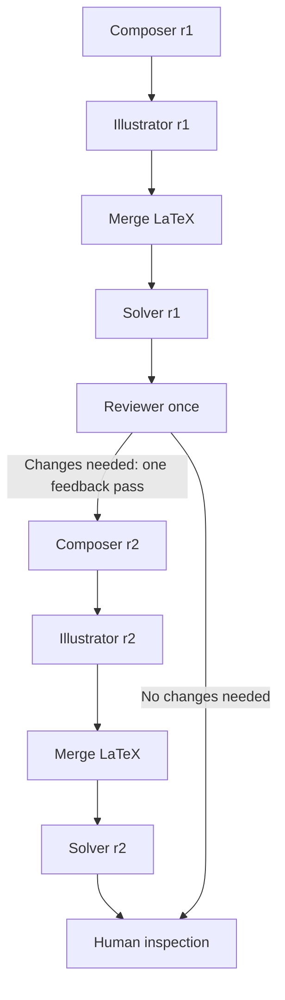

# ASTRA - Pipeline Development Report

**Lab04 - From Spec to Code: Phased Vibe-coding with AI**

| Field | Details |
| --- | --- |
| Student | Nguyễn Phú Trọng - Student ID 25125067 |
| Team / course | Trial and Success / CSC10014 - Computational Thinking |
| Feature | Exam generation and verification with Composer, Illustrator, Solver and Reviewer |
| Version covered | cisr-v3: one Reviewer feedback pass, followed by human inspection |
| Report date | 6 November 2026 |

## Abstract

The pipeline transforms a request containing an exam blueprint into editable LaTeX source. Composer drafts the questions; Illustrator creates TikZ/PGFPlots figures; Python merges the text and figures; Solver solves the exam independently; and Reviewer identifies issues. If changes are needed, feedback returns to Composer exactly once, followed by another Illustrator and Solver pass. The final output always awaits human inspection.

The main development step is the transition from a single content-generation call to a workflow with data contracts, deterministic checks, artifact revisions and resource limits. Each role has its own prompt. Python handles orchestration without requiring an additional model solely for coordination.

## Scope in relation to the assignment

Lab04 asks students to describe how they developed one feature of their course project and permits methods other than Spec Kit. This report follows specification → design → task breakdown → implementation → verification, based on the available source code, documentation and artifacts. It does not claim that the Spec Kit tool was used.

This is the development report for the pipeline feature. Source code, screenshots and an AI usage declaration are separate submission items in the assignment. Version-control material is excluded from this report as requested.

## Evidence standard

Implemented code, replay results, runs resumed from live-model checkpoints and unmeasured targets are distinguished. Valid JSON, HTTP 200 and agreement between agents do not by themselves establish that an exam is correct.

# 01  Feature Specification and Acceptance Criteria

## Problem and intended user

Teachers need exams that satisfy requirements for question counts, question types, difficulty, marks and duration. Questions with figures must preserve the intended data. A single long chatbot response makes these constraints difficult to enforce and makes it hard to locate errors in drafting, illustration or solving.

**User story:** As a teacher, I want to provide an exam blueprint and permitted materials and receive a LaTeX exam, independent solutions, review findings and inspection flags, so that I can approve the exam before using it.

| ID | Requirement / acceptance criterion |
| --- | --- |
| FR01 | Accept a PipelineRequest containing the matrix, bank, context, evidence, visual requirements, optional template and workflow configuration. Reject invalid input. |
| FR02 | Composer produces a draft matching the blueprint. Python checks question counts, types, difficulty, marks and metadata. |
| FR03 | Illustrator is a separate role returning TikZ/PGFPlots code. Figures must match their visual specifications. A text-only exam still includes an Illustrator call returning an empty drawings list. |
| FR04 | Solver receives the student exam and the exact merged LaTeX source, without the Composer answer key, question bank or private evidence. |
| FR05 | Reviewer inspects revision 1 exactly once. Any corrective feedback returns to Composer at most once, including illustration and formatting issues. |
| FR06 | After correction, increment the revision and regenerate figures and solutions. A revision 1 review must not certify revision 2. |
| FR07 | Export de_thi.tex. Store drafts, solutions, reviews, traces, the request and human_review.md under _internal/. |
| FR08 | The final result must have pending_human_review and human_review_required=true. Recording completed human approval is not implemented. |

## Operational constraints

Default limits are 12 provider calls, 120 seconds per call, 600 seconds per run, 100,000 known tokens and 200,000 prompt characters. The default maximums are 120 questions and 12 figures. Token accounting depends on provider-reported usage; missing usage must be recorded rather than treated as complete measurement.

Outside the current scope: a complete product frontend, automatic RAG, distributed queues, cloud deployment, difficulty calibration using student responses and automatic PDF layout verification through vision.

# 02  System Design and Decomposition



| Component | Responsibility and source code |
| --- | --- |
| Orchestration | pipeline/orchestrator.py: stage ordering, correction limits, artifact storage and human handoff. |
| Four roles | pipeline/agents.py: prompts and provider calls for Composer, Illustrator, Solver and Reviewer. |
| Contracts | pipeline/contracts.py, mini.py, models.py: Pydantic schemas for requests, drafts, figures, solutions, reviews and results. |
| Data views | pipeline/views.py: restrict the information sent to Solver/Reviewer and validate figure references. |
| Validation / export | pipeline/stages.py, pipeline/latex.py: stage-output validation, LaTeX, drawing source, templates and optional compilation. |
| Integration | pipeline_cli.py; api.py, POST /v2/exams/generate; pipeline/bootstrap.py assembles providers or replay fixtures. |
| Tracing / evaluation | pipeline/runtime.py records traces and budgets; benchmark.py and reviewer_benchmark.py aggregate measurements. |

## Design rationale

Separate roles make failures easier to locate at a specific checkpoint. Python checks counts and blueprint constraints. Models solve and review the content, but their judgments are not treated as conclusive evidence. Each role can use a separately configured model while the orchestrator enforces a common policy.

Figures are TikZ/PGFPlots code embedded directly in the exam, avoiding PNG dependencies in the main output. Solver reads the source code and formulas; it is not assumed to have inspected a rendered image. Users must still check axes, labels, scale and placement after compilation.

The V1 JSON-generation mode remains a separate baseline; the pipeline uses V2. Both share provider infrastructure but have different contracts and outputs.

# 03  Development Phases with AI

The phases below reconstruct the development process from documentation, code and artifacts. They are not a transcript of the conversation. Illustrative requirements describe the goals of each phase rather than quoting the original prompts.

| Phase | Work and concrete outputs |
| --- | --- |
| 1. Specification | Define the input blueprint, outputs, student/answer separation and stopping conditions. Current policy: docs/PIPELINE_PLAN_AND_BENCHMARK.md. |
| 2. Design | Decompose the workflow into Composer → Illustrator → Solver → Reviewer. Define Pydantic contracts, student/reviewer views, revisions and fingerprints. |
| 3. Task breakdown | Separate contracts, Composer/Illustrator, LaTeX merging, Solver/Reviewer, orchestration/tracing, CLI/API, fixtures and benchmarks. Components communicate through schemas. |
| 4. Incremental implementation | Reuse baseline models, providers and validators. Add separate agents and an orchestrator, plus replay mode to exercise the workflow without external calls. |
| 5. Targeted correction | Compare expected and actual blueprint values; normalize fenced JSON; bind IDs/hashes in Python; enforce Reviewer and callback limits. |
| 6. Verification | Check clean and feedback paths, schema failures, call budgets, answer leakage, stale hashes, source tampering and compilation failures. Save benchmark outputs and artifacts. |

## Decisions refined during development

**From separate images to native LaTeX:** earlier design documents considered PNG/scene-graph approaches. The cisr-v3 policy uses a single .tex file with TikZ/PGFPlots. This report describes the current implementation rather than treating every earlier proposal as a delivered feature.

**From automatic approval to human handoff:** completing the workflow does not establish exam correctness. Reviewer does not run a second time after feedback; the final status must show that the earlier review does not cover the new revision.

**From model-copied metadata to code-bound metadata:** the orchestrator assigns or binds IDs, revisions and hashes, allowing the model to focus on content. This reduces missing-field and hash-copying errors while retaining artifact-link checks.

## Working with AI

Use small requests with contracts and acceptance criteria, inspect the changes, run fixtures/tests and use observed errors to narrow the next correction. AI supports code writing and review, error explanation, documentation and benchmark development. Output evaluation and responsibility for individual contributions remain human tasks.

# 04  Algorithm and Consistency Controls

## Current orchestration algorithm

```text
validate request / template / budgets
for revision in (1, 2):
    draft = Composer(request, feedback)
    drawings = Illustrator(student content, visual specs)
    check draft and drawings; merge LaTeX
    solutions = Solver(student view, merged source)
    if revision == 1:
        review = Reviewer(student view, solutions, requirements)
        if review requests changes or has non-info issues:
            feedback = review + previous draft
            continue
    validate current artifacts; optionally compile
    publish de_thi.tex; write human_review.md; stop
```

The clean path normally uses 4 calls. A single-feedback path uses 7 calls: C/I/S/R followed by C/I/S, excluding initial schema repairs. max_repair_rounds is fixed at 1. An initial schema repair is distinct from a Reviewer feedback cycle. The corrective Composer callback runs once and is not retried if its output has an invalid structure.

## Contracts and artifact binding

SolutionBook references exam_id, draft_id, revision and the LaTeX source artifact_sha256. ReviewReport additionally binds solution_sha256 and the list of checked questions. These checks prevent an old solution or review from being attached to a changed exam. The finalizer checks the source again before export.

The student view excludes Composer answers/solutions, the question bank and private context/evidence. It retains the exam content, choices and drawing code because Solver needs these as problem data. Tests insert marker strings into private inputs to detect leakage into the Solver packet.

## LaTeX and error handling

Templates must contain the required ASTRA_BODY insertion point. Drawing code is restricted to a supported command set, blocking file access and external execution mechanisms such as directlua, gnuplot and external shell commands. Compilation uses no-shell-escape and a timeout. These checks are defensive restrictions, not a proof that every TeX source is safe or compilable.

Provider, schema, timeout, budget and artifact errors are classified by stage, and internal output is retained for diagnosis. Static-only validation is recorded as static. The --compile option requires an available XeLaTeX/LuaLaTeX compiler and successful compilation; a failed compile must not publish a final file as if it had compiled.

# 05  Recorded Results and Measurement Limits

## A 30-question run with one feedback pass

The runs/pipeline/exam_30_verified artifacts describe a 60-minute, 30-mark exam with 30 questions: 20 multiple-choice and 10 short-answer; 10 easy, 15 medium and 5 hard. The trace records gemini-3.1-flash-lite. This model name is reported from the artifact and is not a claim about current service availability.

| Recorded property | Value / interpretation |
| --- | --- |
| execution_status / revision | completed / revision 2; repairs=1; errors=[] |
| Role calls | 7 records: C/I/S/R at revision 1, then C/I/S at revision 2. |
| Call provenance | The first 4 steps reuse checkpoints saved from a live run; the 3 correction steps use chat_completions. This is a resumed run, not 7 fresh API calls from the start. |
| Quality status | pending_human_review; human_review_required=true; machine_approved=false; review_covers_final_revision=false. |
| Compilation | Metadata records latex_validation=compiled. The folder contains de_thi.tex but no output PDF, so this is not treated as evidence of a repeated PDF layout inspection. |

The revision 1 Reviewer flagged formatting issues in q13, where the exponent appeared as text, and q14, where the pi command was escaped as literal text. It recommended math mode. The workflow then produced revision 2. Since Reviewer did not run again, the report does not claim independent confirmation that every issue was resolved.

## Replay pilot comparing two systems

runs/benchmark/native-four-agents/metrics.json records 10 synthetic requests × 2 repeats × 2 systems = 40 attempts. Baseline/text and pipeline/text each have 20 attempts, 0 failures and matrix_full_pass_rate=1.0. The baseline has 20 provider-call records; the pipeline has 80. All results use fixture replay.

human_audit_coverage=0, correct_question_yield=null and total_cost_usd=null. Therefore, 100% blueprint compliance does not establish 100% content correctness. Replay latency does not represent live API speed, and zero cost coverage does not mean the service is free.

## Separate Reviewer evaluation suite

runs/benchmark/native-reviewer contains 20 cases: 10 clean and 10 with seeded arithmetic answer-key errors. Replay yields TP=10, FP=0, FN=0 and recall=precision=1.0. This checks the scoring and evaluation infrastructure; it does not establish equivalent live Reviewer accuracy or general defect-detection ability.

# 06  Verification, Failures and Lessons

## Behavior-focused checks

| Test area | Evidence in the test code |
| --- | --- |
| Clean path / output | test_four_agents_merge_native_latex_then_handoff: all C/I/S/R roles run, the exam contains only student content, and human_review.md is present. |
| Independent solving | test_solver_receives_merged_latex_not_bank_or_composer_key: the packet excludes private inputs and the Composer answer key. |
| Exactly one correction | test_reviewer_feedback_goes_to_composer_once_then_stops; checks also prohibit retrying a failed callback or configuring a second feedback cycle. |
| Data integrity | Checks for stale solution books, source tampering, figure coverage and visual-spec hash binding. |
| Failures / budgets | Call budgets, token/cost accounting for failed calls, timeouts, HTTP errors and compilation failures. |
| API / evaluation | V2 returns LaTeX with a human-review header. Benchmarks retain failed attempts in denominators and leave unlabelled quality metrics unknown. |

These cases verify technical behavior using mocks/fixtures; they do not certify model quality. No total test-pass count is reported without a complete test log. Quantitative results in the results section come from saved benchmark artifacts.

## Failures recorded in run artifacts

exam_30_gemini31 stopped because the difficulty/question-type distribution did not match the specification. exam_30_final lacked spec_sha256 in Illustrator output. exam_30_ready and exam_30_completed encountered Reviewer contract failures. These runs were marked failed rather than publishing apparently complete exams.

Other runs recorded provider_not_found, provider_unavailable or provider_http_error. These are endpoint, model or service failures in the saved runs and must be distinguished from mathematical and orchestration errors. These runs are not used to estimate a general model failure rate.

## Lessons from phased development

Defining counts and contracts first makes correction prompts more specific. Interacting constraints require checks: the total count may be right while the question-type distribution is wrong, and a valid review may still belong to an older revision. Tests should protect these behaviors rather than merely assert that a class or function exists.

Limiting feedback to one pass makes costs and stopping conditions more predictable but leaves final inspection to the user. Stricter contracts expose invalid output more clearly. At the same time, models need clear schema instructions, and code should manage required metadata wherever practical.

# 07  Reproduction, Contributions and Next Steps

## Reproduce without an API key

From the source directory, use Python 3.10 or later, create a dedicated environment and install the dependencies. The CLI output directory must not already exist. The replay commands below do not call a live model.

```text
python -m venv .venv
.\.venv\Scripts\python.exe -m pip install -e ".[dev]" -c requirements-tested.txt
.\.venv\Scripts\python.exe -m exam_baseline.pipeline_cli --request examples/pipeline/text_01/input.json --fixture-dir examples/pipeline/text_01 --output runs/lab04_text
.\.venv\Scripts\python.exe -m exam_baseline.pipeline_cli --request examples/pipeline/visual_graph/input.json --fixture-dir examples/pipeline/visual_graph --output runs/lab04_graph
```

Inspect de_thi.tex, _internal/pipeline_result.json, _internal/drafts/r1/solution_book.json and human_review.md. Add --compile only when a suitable compiler is installed. Live mode requires an authorized service/model configuration. Correction depends on Reviewer output; not every request uses 7 calls.

## Contribution scope

My contribution presented here is building and refining the ASTRA pipeline: translating requirements into contracts, separating the four roles, integrating them through a Python orchestrator, enforcing one feedback pass and adding validation and traces. This report focuses on that technical scope; other parts of the team project are not attributed to this feature.

For this report, AI read the Lab04 brief, compared code, documentation and traces, summarized the development process, interpreted results and formatted the document. A complete prompt history is unavailable, so individual code lines are not attributed to specific tools. The phase descriptions on page 4 are reconstructions rather than an original conversation log.

## Limitations and next steps

An independently labelled dataset is needed to measure question correctness, figure quality and reductions in teacher editing time. Live benchmarks need clear denominators, usage records and complete pricing information, alongside actual PDF layout inspection. Future work may add a computer algebra system (CAS) and choose models by role after measurement, while preserving the stopping policy and human approval step.

## Internal references

[1] Lab04-From Spec to Code-Phased Vibe-coding with AI (1).pdf, all 4 pages; submission requirements on page 3 and the personal-contribution note on page 4. [2] docs/PIPELINE_PLAN_AND_BENCHMARK.md, cisr-v3 policy. [3] src/exam_baseline/pipeline/*, pipeline_cli.py, api.py; tests/test_pipeline.py and test_pipeline_benchmark.py. [4] runs/pipeline/exam_30_verified, including checkpoint_manifest.json, review_report.json and human_review.md. [5] runs/benchmark/native-four-agents/metrics.json and native-reviewer/metrics.json.
