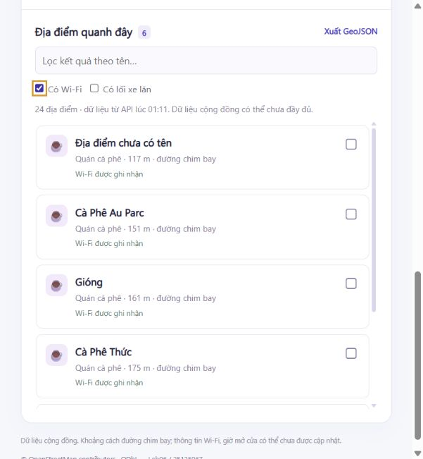

# LAB06 - STUDYSPOT

**Student ID:** 25125067

**Project date:** 20 November 2026 (UTC+7)

**Project:** A website for finding cafes and libraries around a selected point using OpenStreetMap data.

## 1. Requirements and project scope

Lab06 asks each student to build a meaningful website using at least one of the OpenStreetMap and OpenWeather API families, or to document an individual contribution to a group project. StudySpot is an individual website using OpenStreetMap. The assignment does not require both API families or public deployment.

| Requirement | Submission |
| --- | --- |
| Website integrating an API | StudySpot uses the OpenStreetMap API to find nearby places |
| Explanation of features and integration | Sections 2-5 of this report |
| Complete source code | 02_Source_Code, including frontend, server, libraries and tests |
| Video demonstration | 03_Demo/Demo.mp4, an annotated walkthrough using real screenshots |
| AI usage declaration | Section 8 and AI_Usage_Declaration.md |
| Git history | A separate text export of the repository history |
| Documentation in Markdown and PDF | Report.md and Report.pdf contain the same report |

## 2. Purpose and features

Students may need a nearby place to read, study alone or discuss coursework. StudySpot shows cafes and libraries on a map and lets users narrow the results by distance and available OpenStreetMap tags. It suggests places; it does not guarantee that a cafe is quiet, permits long study sessions, or is currently open.

- Choose a suggested area in Ho Chi Minh City, Hanoi, Da Nang or Kon Tum; enter coordinates or click the map to select another center.
- Choose cafes, libraries or both and a radius. The default OSM mode supports 200, 300 and 500 m; the request is sent only when the search button is pressed.
- View markers, the search circle and a list sorted by straight-line distance from the search center.
- Filter loaded results by name, recorded Wi-Fi and wheelchair accessibility without sending another upstream request.
- Inspect the name, address, coordinates, Wi-Fi, original opening-hours tag and link to the source OSM object. Missing information is identified as unavailable.
- Save or remove places using browser localStorage. Saved places remain after reload in the same browser and are not synchronized to an account.
- Export the visible results as GeoJSON with attribution and license information.

## 3. Architecture and technical choices

The frontend uses HTML, CSS, vanilla JavaScript and locally bundled Leaflet 1.9.4. The backend uses the Python 3.10+ standard library. Running the website does not require Flask, Node.js, a database or an API key.

```text
User selects a center and starts a search
  -> app.js sends GET /api/places
  -> server.py validates parameters and checks the cache
  -> GET https://api.openstreetmap.org/api/0.6/map?bbox=...
  -> parse XML, filter amenity=cafe/library, calculate distances
  -> return normalized JSON
  -> frontend renders the list and Leaflet markers

Basemap: the browser loads OpenStreetMap tiles over HTTPS.
Saved places: browser localStorage; they are not sent to the server.
```

The assignment's OSM tutorial illustrates geocoding and reverse geocoding with Nominatim, routing with OSRM, nearby POI searches with Overpass and map display with Folium. StudySpot develops the nearby-POI idea into an interactive website. The optional PlaceService keeps an Overpass `nwr(around:...)[amenity=...]` query, while the website uses Leaflet directly.

The default mode reads a small area from the OSM v0.6 map endpoint and was checked with live data. Overpass remains an explicit `--provider overpass` option; it is not selected automatically. Overpass servers encountered connection, TLS or timeout errors during this project, so that optional mode was not verified successfully against a live service.

The server listens only on 127.0.0.1. This is a small local teaching project, not a public production service. Wider deployment would need an appropriate provider or self-hosted infrastructure, persistent caching, user limits and monitoring.

## 4. OpenStreetMap API integration

### 4.1. Requests and data transformation

An example internal browser request is:

```text
GET /api/places?lat=10.779783&lon=106.699018&radius=300&category=all
```

The backend constructs a bounding rectangle around the circle. For radius r and Earth radius R = 6,371,000 m, latitude offset is degrees(r/R) and longitude offset is degrees(r/(R*cos(latitude))). It then applies the Haversine formula and excludes representative points outside the circle.

```text
GET https://api.openstreetmap.org/api/0.6/map
    ?bbox=106.6962716,10.7770850,106.7017644,10.7824810
```

The API returns XML containing nodes, ways, relations and tags. Nodes have direct coordinates. For a way or relation, the program uses the center of the bounding box of member coordinates present in the response. An object is skipped if it lacks enough coordinates. This representative point is not necessarily an entrance. Different OSM IDs can describe the same physical business; deduplication only uses type and ID.

Objects tagged amenity=cafe or amenity=library are normalized into id, name, category, lat, lon, distance_m, address, wifi, wheelchair, opening_hours and osm_url. Wi-Fi is treated as available when internet_access=wlan or wifi=yes is present. A missing tag does not mean a facility is absent.

### 4.2. Error handling and resource limits

- Only the expected parameters are accepted; arbitrary category values, duplicate parameters, NaN, infinity and out-of-range coordinates are rejected.
- Direct OSM mode limits the radius to 500 m, latitude to plus or minus 85 degrees, and rejects regions crossing the 180-degree meridian or responses larger than 8 MB.
- The in-memory cache lasts 10 minutes and holds at most 64 areas or queries. Category changes in the same OSM area reuse the extract. A lock serializes network requests.
- New upstream requests are at least five seconds apart. The interface does not poll, autocomplete addresses or search automatically when the map is moved.
- The backend network timeout is 40 seconds and the frontend cancels after 45 seconds. Errors are reported, and previous results remain visible with a notice if a new request fails.
- At most 100 places are displayed; a truncated flag indicates a limit was reached. Nearest-first ordering applies only to received data and does not guarantee complete real-world coverage.
- External text is inserted with textContent instead of being concatenated into HTML. The server does not expose directory listings or paths outside web/.

The basemap uses the official HTTPS tile URL and visible attribution. It does not bulk-download tiles, create offline tile packages, disable HTTP caching or bypass TLS validation. Tiles and POI data are separate; the result list remains usable if tiles fail to load.

### 4.3. GeoJSON

GeoJSON uses [longitude, latitude] coordinate order. The export retains the source, ODbL license and export time. When exporting saved places, query=null and the distance is identified as referring to the original search center. The buildGeoJSON function is shared by the frontend and offline tests.

## 5. Running and using the website

1. Install Python 3.10 or later if needed. No API key is required.
2. Open a terminal in 25125067_W06_01/02_Source_Code.
3. Run the command below and open http://127.0.0.1:8086.

```powershell
python server.py
```

4. Select Notre-Dame Cathedral in Ho Chi Minh City, 300 m, and cafes and libraries; press the search button.
5. Try the Wi-Fi filter, inspect Cà Phê Au Parc, save it and check the saved tab.
6. Use the GeoJSON export button. Stop the server with Ctrl+C in the terminal.

If the port is busy, use `python server.py --port 8087` and open that port. Do not open index.html using file:// because the frontend requires the server endpoint. Internet access is needed for the API and tiles. Saved evidence is not substituted silently for live data when the network fails.

Optional Overpass mode:

```powershell
python server.py --provider overpass
```

This mode accepts a radius up to 2 km, limits the upstream response to 300 objects and 4 MB, and displays at most 100 results. OVERPASS_URL may be set to a suitable HTTPS endpoint. Use a service with valid HTTPS rather than bypassing certificate checks.

## 6. Validation and evidence

### 6.1. Automated tests

```powershell
python -m unittest discover -s tests -v
node --test tests/geojson.test.cjs
```

Node.js 18+ is needed only for the JavaScript tests, not for running the website. The recorded result was **11 Python tests and 3 JavaScript tests passed**; see 04_Testing/test_results.txt.

The tests cover input validation, Haversine, nodes/ways/relations, missing tags, zero coordinates, deduplication, radius limits, caching and expiry, concurrency, output limits, network/HTTP/XML/JSON errors, oversized responses, HTTP routes, path isolation, GeoJSON coordinate order and saved-place distance references. Fixtures are synthetic data and are not presented as live API responses.

### 6.2. Live browser check

For center 10.779783, 106.699018 and a 300 m radius, the retrieval on 20 November 2026 at 01:11:07 UTC+7 found 25 POIs of the selected types in the bounding box, of which 24 representative points were within the circle. Enabling the Wi-Fi filter left six places; the wheelchair filter was off. This dataset contained no wheelchair=yes point.

Cà Phê Au Parc appeared 151 m away in a straight line, with address 32 Hàn Thuyên, a Wi-Fi tag and limited wheelchair access. These details are the OSM data received at that time, not an on-site verification of the business.

The browser check observed place details, saving a place and retaining it after reload. A non-matching name filter produced an empty list. The results interface was directly checked at a viewport width of about 601 px; CSS also contains wide and narrow layouts. It was not tested on every device or browser.

The live_api_response.json file contains the server's normalized response. The saved copy was read from cache, so meta.cached=true; fetched_at retains the original retrieval time.

The GeoJSON export action displayed a success message. The testing browser did not expose a Blob download path, so the downloaded file itself was not verified there. The sample GeoJSON in 03_Demo was generated using the same buildGeoJSON function from the saved live response, filtered to the six Wi-Fi results. The payload is covered by separate automated tests.



## 7. Demonstration video and limitations

Demo.mp4 is a Vietnamese-captioned video assembled from screenshots of real website interactions; it is not a continuous screen recording. It presents the map, live API results, filters, place details, saving, data export and endpoint information. Original screenshots and an additional Demo.srt subtitle file are included.

Community data can be missing or outdated. An area's representative point need not be its entrance. The website does not provide routing, walking times, weather or an interpretation of opening-hours expressions as currently open/closed. Saved data can become stale or be lost when browser data is cleared. Direct OSM mode is intended for a small local exercise, not large-area scraping. External-service errors are shown without silently substituting invented results.

Git history is exported separately after the homework commit. The history file documents actual commits rather than a fabricated development record.

## 8. AI usage declaration

Codex assisted with analyzing the assignment, explaining syntax and API flow, proposing the architecture and interface, writing most initial source code, creating tests, debugging, drafting notes and the report, correcting spelling and assembling the demonstration video. Live API responses and browser screenshots were used as evidence; test fixtures are labeled as synthetic.

The work is not presented as independently written without AI. The student should review, run and understand the code before submission. Leaflet is a third-party BSD-2-Clause library; map data is credited to OpenStreetMap contributors under ODbL in the app, export and report. See AI_Usage_Declaration.md for the separate declaration.

## 9. References

- Original assignment: 00_Assignment/Lab06.pdf.
- [Assignment's OpenStreetMap tutorial](https://colab.research.google.com/drive/1OCDkawCcsBrAVOMNw5bvlH5zQl_GqQ7y?usp=sharing): geocoding, routing, nearby POIs and Folium.
- [OSM API v0.6](https://wiki.openstreetmap.org/wiki/API_v0.6): map bounding-box endpoint and data objects.
- [Overpass API](https://wiki.openstreetmap.org/wiki/Overpass_API): syntax, servers and usage considerations.
- [Overpass QL](https://wiki.openstreetmap.org/wiki/Overpass_API/Overpass_QL): around, nwr and out center.
- [Leaflet 1.9.4](https://leafletjs.com/reference-1.9.4.html): map, marker, circle, popup and tiles.
- [Tile Usage Policy](https://operations.osmfoundation.org/policies/tiles/): HTTPS, attribution and tile caching.
- [OpenStreetMap Copyright and License](https://www.openstreetmap.org/copyright): attribution and ODbL.

Documentation and tests reviewed: 20 November 2026.
